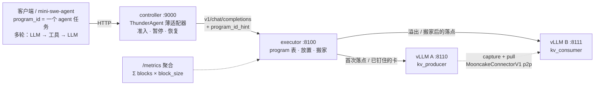
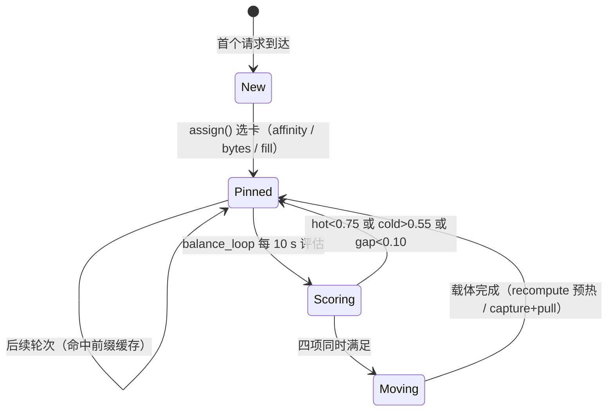

# 设计框架图（路线甲：ThunderAgent 本体 + program 级放置/搬运）

## 1. 分层



三层职责：

| 层 | 谁 | 决定什么 | 不决定什么 |
|---|---|---|---|
| 控制面 | controller(ThunderAgent 语义) | **准入**：并存的 program 上下文总量 ≤ 容量；超了就暂停 / 恢复 | 某个 program 放哪张卡 |
| 我们的层 | executor | **放置**（首轮落点、亲和）与**搬家**（何时把 program 挪到另一张卡） | 是否该跑、要不要等 |
| 后端 | vLLM | 前缀缓存命中/驱逐、KV 块的物理存放 | 谁该来 |

## 2. 一个 program 的生命周期



## 3. 2×2 设计空间

```
                    搬家关闭                     搬家开启
放置: pin 数    pin-off  ← 基线             pin-on  ← 仅看搬家收益
放置: 字节预算  bytes-off ← 仅看放置收益    bytes-on ← 组合
```

## 4. 与两条参考路线的定位

| 能力 | Llumnix | ThunderAgent | 我们（路线甲） |
|---|---|---|---|
| 请求级放置 | ✅ GlobalScheduler + 策略族 | ✅ program 亲和 | ✅ program 亲和 + 字节预算 |
| 准入/节流 | ❌（靠引擎自身） | ✅ 容量记账 + 暂停恢复 | ✅ 复用 TA |
| KV 迁移 | ✅ 块级、近无损 | ❌ | ⚠️ 重算式交接 / capture+pull（非块级） |
| 迁移触发 | 每个调度周期都可搬 | 无 | 仅在 hot/cold/gap 同时满足时 |

## 5. 已知边界

- 本平台无块级迁移通道（store / LMCache / offload 三条全不通），所以“近无损”做不到，只能“重算式交接”。
- 搬家只有在“不搬就会反复整段重算”时净赚；两卡均衡或总量超容时都是负收益。
